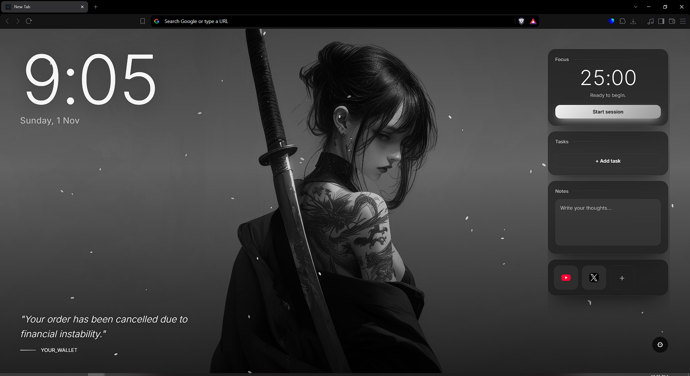

# New Wallpaper Theme

> A clean, minimalist, and privacy-focused New Tab extension. This is a community refactor of an existing extension.

## 📖 Overview

This project is a refactored version of an existing "Anime Cute Girls HD Wallpaper New Tab" extension. The original extension had a beautiful UI but was cluttered with intrusive features, unwanted advertisements, and tracking links. This version focuses on providing a clean, minimalist, and private "New Tab" experience.

> **Note:** A significant portion of the code refactoring, bug fixing, and feature enhancements in this project was achieved with the assistance of Artificial Intelligence (AI) tools. AI was used to optimize the code structure, remove malicious/unwanted scripts, and improve the overall user experience.

## ✨ Key Improvements

### 1. Removed Intrusive & Annoying Features
The original developer injected several unwanted behaviors into the extension, which have been completely removed:
* **Removed Adware/Marketing Links:** Deleted the code that forcefully opened the developer's website (`cawallpaper.com`) upon installation or updates.
* **Removed Uninstall Tracking:** Removed the `setUninstallURL` function that redirected users to the developer's site when the extension was uninstalled.
* **Removed the Annoying Tab Favicon:** The original extension forced a random anime girl image to appear next to the "New Tab" title. This has been permanently removed for a cleaner look.
* **Cleaned Up `manifest.json`:** Removed unnecessary permissions, update URLs, and localization folders (`_locales`) to make the extension lighter and faster.

### 2. Code & Performance Optimizations
* **Refactored `app.js`:** The JavaScript code was cleaned up, optimized, and made more readable.
* **Removed Dead Code:** Stripped out unused variables, functions, and legacy code.
* **Improved UI/UX:** Ensured the background wallpaper changes smoothly and the widgets (Tasks, Notes, Pomodoro) function without glitches.

### 3. Privacy & Security
* **No Remote Tracking:** The extension no longer pings external servers for updates or tracking.
* **Local Storage Only:** All user data (tasks, notes, settings) is stored locally on the user's machine using `chrome.storage.local`. No data is sent to the original developer.

## 🛠️ Installation

Since this is a modified version and not on the Chrome Web Store, you need to install it in "Developer Mode":

1. Download or clone this repository to your local machine.
2. Open your Chromium-based browser (Google Chrome, Brave, Microsoft Edge, etc.).
3. Go to the Extensions page:
   * Chrome/Brave: `chrome://extensions/` or `brave://extensions/`
   * Edge: `edge://extensions/`
4. Enable **Developer mode** (toggle in the top right corner).
5. Click on **Load unpacked**.
6. Select the folder of this project (the folder containing `manifest.json`).
7. Open a new tab and enjoy!

## 📂 Project Structure

* `manifest.json`: The core configuration of the extension (cleaned and optimized).
* `newtab.html`: The HTML structure of the new tab page.
* `css/style.css`: The styling and layout.
* `js/app.js`: The main logic for the clock, tasks, notes, and wallpaper switching.
* `background.js`: Minimal service worker (cleaned from external links).
* `img/`: Contains the wallpapers and the custom icon.

## 🤝 Credits & Disclaimer

* **Original Idea/Base:** This project is based on an existing extension found on the Chrome Web Store. All credits for the original design and layout go to the original developer.
* **Refactoring & Improvements:** Done by me (and AI assistance) to create a cleaner, ad-free, and privacy-focused experience.

## 📄 License

This project is licensed under the MIT License - see the [LICENSE](LICENSE) file for details.
